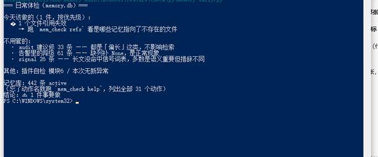
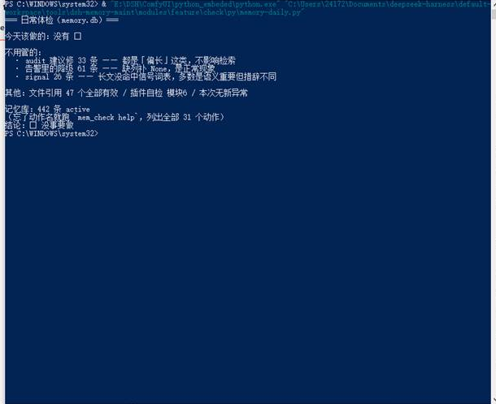

# dsh-memory-maint

给 **DSH 记忆库**做维护的一套工具：**体检、去重、衰减、检索、备份**。

> 43 个 Python 脚本 / 6076 行 · 6 个 MCP 工具 / 37 个动作
> 逻辑全在 Python，Node 层只做工具注册与转发。

---

## 为什么做这个

记忆库就是一个 SQLite 文件，跑久了会积出这些问题：

- 同样的内容被记了好几遍
- 该褪色的旧条目还占着检索位
- 记忆里引用的文件路径早就没了
- 重要性标得不对（该 4 的标成 1，或者反过来）
- 有约定带了期限，到点了没人提醒

一条条手动查太慢。所以做成一套**跑一条命令就出结论**的工具。

## 一眼看效果

**发现问题时**（🔗 两个文件引用失效）：



**一切正常时**：



`mem_check`（不传参数就是日常体检）：

```
=== 日常体检（memory.db）===

今天该做的（1 件，按优先级）：
  🔗 2 个文件引用失效
     → 跑 `mem_check refs` 看是哪些记忆指向了不存在的文件

不用管的：
  · audit 建议修 28 条 —— 都是「偏长」这类，不影响检索
  · 告警里的降级 60 条 —— 缺列补 None，是正常现象
  · signal 26 条 —— 长文没命中信号词表，多数是语义重要但措辞不同

其他：插件自检 模块 6 / 本次无新异常

结论：⚠ 1 件事要做
```

**刻意分成三区**：该做的 / 不用管的 / 其他。
把"提醒"和"问题"分开，避免报警疲劳——**修不好的东西不进日报，否则人会对警告脱敏**。

## 六个工具，一句话各管什么

| 工具 | 一句话 | 动作数 |
|---|---|---|
| `mem_check` | **体检**：今天该做什么 / 写得对不对 / 引用还在不在 / 这个项目有什么 | 16 |
| `mem_maint` | **整理**：去重、衰减、索引、时间线、图谱 | 7 |
| `mem_query` | **查**：按项目、按人、按词、按关系、按文件（含 `--json`） | 8 |
| `mem_backup` | **救生**：导出成纯文本 / 从纯文本重建（**默认关闭**，见下） | 2 |
| `mem_alert` | **告警**：插件自己有没有带病运行 | 2 |
| `mem_status` | **自检 + 诊断包**：模块/脚本/契约层连不连得上；出 BUG 用 `mem.py diag` 打一份脱敏诊断贴给开发者 | 2 |

**`mem.py <动作名>` 可以直接写**（`mem.py daily` == `mem.py check daily`）——不用记它在哪个工具下。

**忘了动作名**：跑 `mem.py help`——它先按「我想干什么」列，再给完整清单。

**AI 看到的不是 37 个名字，是 6 个工具**——每个工具的 `action` 参数有 `enum`，动作名在里面选，不用背。

## 配置（七段，改完即时生效）

配置在 **`config.json`**，默认位置是**你工作区的** `tools/dsh-memory-maint/config.json`
（**不放在插件包里**——那样升级会把你的配置覆盖掉）。

```
agent.name       AI 的名字（默认 DeepSeek）
tools.<工具名>   开关（配 false = 关掉，1 秒内生效）
assets.<项目>    项目资产要扫哪些目录
backup.targets   备份放哪几处
backup.exportDir 导出到哪
start.checklist  开工清单（可换成你自己的规则）
paths.*          本机设施路径（没配就跳过）
```

⚠ **`mem_backup` 默认是关的**：它是救生工具（导出/恢复），但**备份到哪只有你知道**——
默认 `targets` 为空时它跑起来什么也不做，反而像坏了。要用就配 `tools.mem_backup: true`。

细节见 [`docs/CONFIG.md`](docs/CONFIG.md)。

## 和 meow-memory 的分工

本插件**不重复造记忆的读写**——那是 [`meow-memory`](https://github.com/Phant0Meow/dsh-meow-memory) 的事。我们管的是**「记忆健不健康」**：

| 功能 | `meow-memory`（本体） | 本插件 |
|---|---|---|
| **存 / 改 / 归档** | ✅ `memory_remember` / `memory_update` | ❌ 不重复造 |
| **检索** | ✅ `memory_search`（BM25 + 自动注入） | ✅ **增强**：`why`（为什么命中）/ `expand`（1 跳关联）/ `hipporag`（多跳）/ `file` / `dump` |
| **项目视角** | ✅ `memory_project`（注入给模型的格式） | ✅ `project`（**统计视角**：条数 / 分布 / 最近更新 / 待办 / 重复嫌疑） |
| **体检** | ❌ | ✅ `mem_check` **16 个动作** |
| **维护** | ✅ `memory_dream`（只整理**当前窗口**） | ✅ `mem_maint` **7 个**（其中 `dream` 补全库盲区） |
| **备份** | ❌ | ✅ `mem_backup`（**自包含救生圈**，插件坏了也能跑） |
| **告警 / 自检** | ❌ | ✅ `mem_alert` / `mem_status` |

**一句话**：本体管「记忆怎么活」，本插件管「记忆健不健康」。

**「查」这一类**包括了 `mem_query` 的 8 个：`expand`（1 跳）/ `hipporag`（多跳）/ `file`（**文件式检索**：搜 `memory-export/` 的副本 + `docs/`）/ `dump`（导出）/ `people`（人物）/ `assets`（项目资产）/ **`why`（为什么命中）** / **`project`（项目全景）**。

忘了动作名就跑 `mem_check(action="help")`——它先按「我想干什么」列，再给完整清单。

## 遇到问题怎么办

### 先打一份诊断包

```bash
mem.py diag --out diag.txt
```

它会打包 **版本 / 环境 / 最近错误 / 运行流水 / 配置（已脱敏）**——
**脱敏**：token / 密码 / 密钥 → `***`；**本机路径只保留最后两段**（看不到你的用户名）。

**自己看一眼再决定发不发**，文件是纯文本，7 KB 左右。

### 往哪发

| 方式 | 适合 |
|---|---|
| **[提 Issue](https://github.com/scrapfox149/dsh-memory-maint/issues/new/choose)** | 行为不对、报错、跟文档不符——**模板会提示你贴 `diag`** |
| **邮件 `scrapfox149@foxmail.com`** | 不方便公开的（涉及你自己的数据） |

提 Issue 时**把 `diag.txt` 拖进去当附件**就行，不用手工整理。

### 想直接看错误

```bash
mem.py alert          # 插件自己记的错误（一行一条 JSON，来自 state/errors.jsonl）
mem.py status         # 模块 / 脚本 / 契约层 / 库，连不连得上
```

## 架构

```
lib/index.js          控制层：发现模块 + 注册工具，不含任何业务逻辑
modules/
  feature/            逻辑层
    check/              mem_check   16 动作
    maint/              mem_maint    7 动作
    query/              mem_query    8 动作
  observe/            观察层
    alert/              mem_alert    2 动作
    status/             mem_status   2 动作（status / diag）
  backup/             救生层（有意自包含）
    rescue/             mem_backup   2 动作
py-core/              基础层
  mem_db.py             连库 / 探列 / 缺列补 NULL / 状态计数 / 写日志
  decay.py              衰减公式（max(0) 写死，以后不可能漏）
  text.py               分词 / Jaccard / 关键词集合
  out.py                输出格式（title / section / item / action）
```

**层间规矩**

- 控制层只认 `module.json`，**不知道任何业务逻辑**
- 逻辑层不许依赖观察层
- 基础层谁都能用，它不依赖任何人
- **救生层有意自包含**：不依赖契约层，插件整个坏掉也能跑

## 设计原则

1. **一个职责只有一份实现** —— 衰减公式曾经散落在三个脚本里、三种写法，一天内出过两次不一致；现在收在 `py-core/decay.py`，改一处就够
2. **调用单行道**：Node → Python，Python 不回调
3. **数据通路唯一**：所有库访问走 `py-core/mem_db.py`（`export`/`restore` 例外，见下条）
4. **保命工具不依赖被保对象**：`memory-export` / `memory-restore` 自包含，随备份归档一起存，插件坏了也能从导出重建整个库
5. **检查不能「永久红」**：修不好的问题（比如已归档条目里的旧路径）不进日报

## 状态

- 41 个 Python 脚本 / 4264 行（测试在 tests/ 里另有 5 个 / 871 行）
- 冒烟测试 **30/30**
- 已装进 desktop profile

## 开发

改代码前先读 [`docs/DEVELOPING.md`](./DEVELOPING.md) —— 里面有架构细节、加东西的流程、测试清单，**和十三个踩过的坑**。

版本历史见 [`CHANGELOG.md`](./CHANGELOG.md)。

## 可配置项

七段配置全在 `config.json`（默认放工作区的 `tools/dsh-memory-maint/`，**升级不丢**）（AI 名字 / 开工清单 / 工具开关 / 备份路径 / 本机设施 / 导出去向），
**改配置不用改代码**。每一项的说明、默认值、常见问法见 **[docs/CONFIG.md](docs/CONFIG.md)**。

跑 mem_check help 也能看到摘要——**AI 第一次运行就能知道有这些可配置**。

## 安装

**前置**：先装 [`meow-memory`](https://github.com/Phant0Meow/dsh-meow-memory)——本插件维护的是它的库。

### 1. 登记到 profile

编辑 `~/.dsh/profiles/desktop/package.json`，两处都要加：

```json
{
  "dependencies": {
    "dsh-memory-maint": "file:./node_modules/dsh-memory-maint"
  },
  "dsh": {
    "profile": {
      "bundles": ["dsh-memory-maint"]
    }
  }
}
```

> ⚠️ **必须用 `file:` 协议**。写成版本号（如 `"0.2.0"`）会被当成 registry 包，pnpm 去 npm 上找、
> 找不到，**整个 `pnpm install` 失败**——而且症状看起来像"新插件有问题"，实际是这条埋的雷。

### 2. 让改动生效

| 改了什么 | 怎么生效 |
|---|---|
| Python 脚本（`py-core/`、`modules/`） | **下次调用即生效**（每次都是新进程） |
| `lib/index.js` | **必须重启宿主**（desktop 版只能人工重启） |

### 3. 验证

调 `mem_status`（不传参数），应该看到：

```
模块 6 个 / 脚本 35 个
  ✅ backup   rescue   mem_backup   命令 2 / 脚本 2
  ✅ feature  check    mem_check    命令 13 / 脚本 13
  ...
```

看不到这行就是没装好——**别用"没报错"当装好了**。

## 依赖

- **`meow-memory`**（记忆库本体）—— 本插件的全部工具都读写它管理的那份 SQLite；
  没有它，这套维护工具**没有对象可维护**。两者是「库」与「维护工具」的关系，不是替代关系
- Python 3.10+（默认取宿主运行时自带，可用 `DSH_MEMORY_PYTHON` 覆盖）

## 许可

MIT
